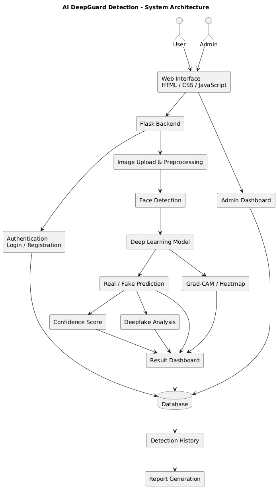
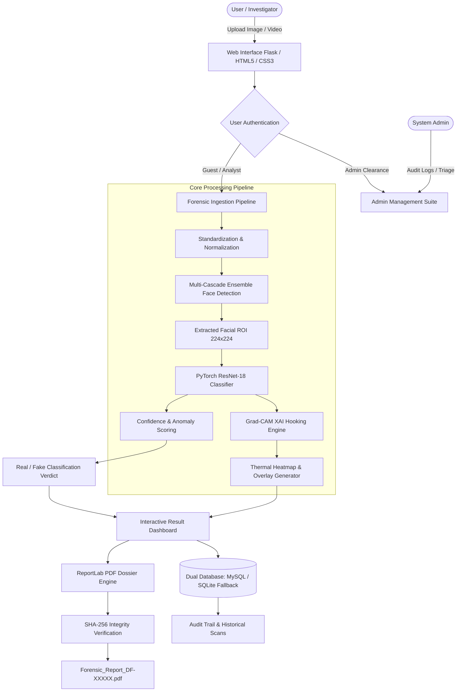

# 🛡️ AI DeepGuard — Deepfake Detection & Digital Forensics System

<p align="center">
  
</p>

<p align="center">
  <strong>Deep Neural Network-driven Synthetic Media Detection with Explainable AI (Grad-CAM), Multi-Cascade Facial Localization, and Cryptographic Forensic PDF Dossier Generation.</strong>
</p>

<p align="center">
  <a href="#-system-architecture"></a>
  <a href="#-explainable-ai-grad-cam"></a>
  <a href="#-technology-stack"></a>
  <a href="#-installation--quick-start"></a>
  <a href="#-database-architecture"></a>
  <a href="#-academic-credentials--credits"></a>
</p>

---

## 📌 Table of Contents

- [Overview](#-overview)
- [Key Features](#-key-features)
- [System Architecture](#-system-architecture)
- [12 Core Architectural Modules](#-12-core-architectural-modules)
- [Explainable AI (Grad-CAM)](#-explainable-ai-grad-cam)
- [Research Foundations & Citations](#-research-foundations--citations)
- [Technology Stack](#-technology-stack)
- [Repository Structure](#-repository-structure)
- [Installation & Quick Start](#-installation--quick-start)
- [Database Configuration](#-database-configuration)
- [Usage & User Guide](#-usage--user-guide)
- [Model Training & Evaluation](#-model-training--evaluation)
- [Forensic PDF Dossier Specification](#-forensic-pdf-dossier-specification)
- [Academic Credentials & Credits](#-academic-credentials--credits)
- [Disclaimer & License](#-disclaimer--license)

---

## 🧠 Overview

The rapid democratization of generative artificial intelligence and diffusion models has made the creation of hyper-realistic facial manipulations (*deepfakes*) accessible to bad actors. These fabrications pose severe threats to biometric security, identity authenticity, judicial proceedings, and public trust.

**AI DeepGuard Detection** is an enterprise-grade digital forensic verification platform designed to ingest suspicious multimedia (images and video streams), detect generative facial synthesis, generate localized heatmaps exposing manipulation artifacts, and produce cryptographically verifiable chain-of-custody forensic reports.

Unlike black-box classifiers that output a raw score with no transparency, AI DeepGuard integrates **Explainable AI (XAI) via Grad-CAM**, allowing cyber investigators, digital forensics experts, and academic researchers to visually trace the exact facial boundaries, blending discontinuities, and texture warping that led to the model's verdict.

---

## ⚡ Key Features

- **🔍 Multi-Cascade Ensemble Face Detection**: Leverages OpenCV frontal, alternate, and profile Haar cascades to accurately segment facial ROIs even under severe head turns, low lighting, or partial occlusion.
- **🔬 Deep Residual Feature Extraction**: Built upon PyTorch **ResNet-18** fine-tuned on benchmark deepfake manipulation datasets (`model/best_resnet.pth`).
- **🔥 Explainable AI via Grad-CAM**: Computes gradient-weighted class activation heatmaps across the final convolutional layers (`layer4`), rendering side-by-side artifact maps and color-mapped overlays (JET colormap).
- **🎞️ Temporal Video Frame Analysis**: Deconstructs uploaded video files into sequence frames, scores inter-frame anomaly consistency, and derives aggregate confidence metrics.
- **📄 Cryptographic Forensic PDF Dossiers**: Generates tamper-evident PDF inspection certificates with **SHA-256 integrity digests**, confidence breakdowns, suspect cropped regions, and investigator sign-offs via ReportLab.
- **🔄 Resilient Dual-Engine Database**: Connects directly to **MySQL**, with automatic zero-configuration failover to a local **SQLite** database (`deepfake_local.db`) if MySQL is unavailable.
- **🛡️ Role-Based Access Control (RBAC)**: Secure authentication system with salt-hardened PBKDF2:SHA256 password hashing separating public analysts and system administrators.
- **📊 Interactive Forensic Dashboard**: Real-time confidence dials, probability matrices (Real vs. Fake), quick-action sample benchmark testing, and historical audit trails.
- **🤖 Interactive Forensic AI Chatbot**: Built-in intelligent conversational assistant explaining the end-to-end pipeline from account registration to final cryptographic dossier generation, with interactive prompt chips and session memory.
- **👮 Incident Complaint & Escalation Pipeline**: Integrated cybercrime reporting module allowing victims and analysts to compile evidence dossiers for law enforcement triage.

---

## 🏗️ System Architecture



### Complete End-to-End Workflow

1. **User Authentication / Session Clearance**: Analyst registers/logs in; credentials hashed with `pbkdf2:sha256`.
2. **Media Ingestion & Validation**: Files validated against strict MIME and size caps (50 MB max payload).
3. **Multi-Scale Face Extraction**: OpenCV detects frontal/profile facial boundaries and isolates the ROI.
4. **ResNet-18 Inference**: PyTorch evaluates normalized facial tensors against binary cross-entropy decision bounds.
5. **Class Activation Mapping (Grad-CAM)**: Backpropagates target class gradients to layer4 activation maps to highlight artifact hotspots.
6. **Persistence**: Ingestion metadata, timestamps, probabilities, and relative file paths are logged in the database.
7. **Report Compilation**: ReportLab compiles an official chain-of-custody PDF complete with cryptographic hashes and visual exhibits.

---

## 📦 12 Core Architectural Modules

| # | Module Name | Primary File | Description |
|---|-------------|--------------|-------------|
| **1** | **User Authentication & RBAC** | `core/auth.py` | Session control, clearance enforcement, registration validation. |
| **2** | **Image & Media Ingestion** | `app.py` | Secure filename sanitization, UUID hashing, 50MB payload limits. |
| **3** | **Preprocessing & Face Isolation** | `core/detector.py` | Multi-cascade OpenCV detection, face scaling to 224×224 tensors. |
| **4** | **Deepfake Detection Engine** | `core/detector.py` | PyTorch ResNet-18 classification for binary authenticity. |
| **5** | **Confidence & Anomaly Scoring** | `core/detector.py` | Softmax probability computation and artifact severity metrics. |
| **6** | **Explainable AI (Grad-CAM)** | `core/gradcam.py` | Backward gradient hooking on conv-layers to pinpoint manipulated regions. |
| **7** | **Forensic Result Dashboard** | `templates/result.html` | High-fidelity UI displaying verdicts, confidence gauges, and overlays. |
| **8** | **Detection History Audit Trail** | `templates/history.html` | Chronological case history, search, and record deletion. |
| **9** | **Cryptographic PDF Dossier** | `core/report_gen.py` | Tamper-evident PDF export with SHA-256 integrity hash via ReportLab. |
| **10** | **Dual Database Persistence** | `db.py` | Enterprise MySQL with automated, zero-config SQLite failover. |
| **11** | **Administration & Triage Suite** | `templates/admin_panel.html` | User account lifecycle, scan surveillance, and system statistics. |
| **12** | **Security & Parameter Sanitization** | `core/auth.py`, `app.py` | CSRF guard, SQL injection protection, route decorators (`@admin_required`). |
| **13** | **Forensic AI Chatbot Guide** | `core/chatbot.py`, `static/js/chatbot.js` | Interactive end-to-end system tutor explaining registration to PDF dossier generation. |

---

## 🔬 Explainable AI (Grad-CAM)

Traditional CNN detectors suffer from the *"black-box"* dilemma: they classify media without justifying their decision. In digital forensics and legal testimony, unexplained predictions are inadmissible.

AI DeepGuard implements **Gradient-weighted Class Activation Mapping (Grad-CAM)**:

$$L_{\text{Grad-CAM}}^c = \text{ReLU}\left(\sum_k \alpha_k^c A^k\right)$$

Where neuron importance weights $\alpha_k^c$ are computed by global average pooling the gradients of class score $y^c$ with respect to feature activation map $A^k$:

$$\alpha_k^c = \frac{1}{Z} \sum_{i} \sum_{j} \frac{\partial y^c}{\partial A_{i,j}^k}$$

- **Thermal Highlighting**: Areas showing synthetic blending boundaries, GAN artifacts, frequency mismatches, and unnatural skin textures light up in **red/orange**.
- **Context Preservation**: The heatmap is blended onto the facial crop with an alpha transparency factor ($0.4$), giving investigators clear anatomical reference points.

---

## 📚 Research Foundations & Citations

The architecture and methodology of AI DeepGuard are inspired by and aligned with recent benchmark literature in digital media forensics:

1. **LAA-Net (CVPR 2024)**  
   *Nguyen et al.* — *"LAA-Net: Localized Artifact Attention Network for Quality-Agnostic and Generalizable Deepfake Detection"*, IEEE/CVF CVPR 2024.  
   *Relevance*: Demonstrates that focusing attention on localized artifact-prone regions significantly outperforms global full-image classification.
2. **SIDA (CVPR 2025)**  
   *Huang et al.* — *"SIDA: Social Media Image Deepfake Detection, Localization and Explanation with Large Multimodal Model"*, IEEE/CVF CVPR 2025.  
   *Relevance*: Establishes the three-pillar paradigm adopted by our system: **Detection + Localization + Visual Explanation**.
3. **Hybrid BoVW + Multi-CNN (2026)**  
   *Alrahhal et al.* — *"Deepfake Face Detection Using Hybrid Bag-of-Visual-Words and Multi-CNN Feature Fusion"*, 2026.  
   *Relevance*: Highlights the synergy between handcrafted forensic cues and deep convolutional representations.
4. **FaceForensics++ (ICCV 2019)**  
   *Rössler et al.* — *"FaceForensics++: Learning to Detect Manipulated Facial Images"*, ICCV 2019.  
   *Relevance*: Standardizes facial forgery benchmarks across Deepfakes, Face2Face, FaceSwap, and NeuralTextures.

---

## 🛠️ Technology Stack

| Layer | Technologies |
|---|---|
| **Deep Learning & AI** | PyTorch (`torch>=2.0.0`), Torchvision, Pretrained ResNet-18, Custom Grad-CAM XAI |
| **Computer Vision** | OpenCV (`opencv-python>=4.8.0`), PIL (`Pillow>=9.5.0`), NumPy |
| **Web Framework & Backend** | Flask (`Flask>=2.3.0`), Jinja2, Werkzeug (PBKDF2 Password Hashing) |
| **Document Engineering** | ReportLab (`reportlab>=4.0.0`), Cryptographic `hashlib` (SHA-256) |
| **Database & Persistence** | MySQL 8.0 (`mysql-connector-python>=8.0.0`), SQLite3 (Zero-config automatic fallback) |
| **Frontend & UX** | HTML5, CSS3 (Modern Glassmorphism & Forensic Dark Mode), Vanilla JavaScript |

---

## 📂 Repository Structure

```
DEEPFAKE-DETECTION-SYSTEM/
│
├── core/                               # Core AI & Forensic Engine Modules
│   ├── __init__.py                     # Module package initializer
│   ├── auth.py                         # Authentication validation & clearance decorators
│   ├── detector.py                     # DeepfakeDetector engine (OpenCV + PyTorch inference)
│   ├── gradcam.py                      # Grad-CAM class activation & heatmap generator
│   └── report_gen.py                   # ReportLab PDF forensic dossier generator
│
├── model/                              # Model Checkpoints & Weights
│   └── best_resnet.pth                 # Trained PyTorch ResNet-18 weights (~44.8 MB)
│
├── templates/                          # Jinja2 Frontend Templates
│   ├── base.html                       # Base layout with navigation and forensic theme
│   ├── index.html                      # Analysis portal (upload, scanner, quick benchmark)
│   ├── result.html                     # Visual dossier, Grad-CAM toggle, confidence metrics
│   ├── history.html                    # Historical scan audit trail
│   ├── login.html                      # User / Analyst authentication
│   ├── register.html                   # Account creation portal
│   ├── admin_login.html                # Administrator login redirect
│   ├── admin_panel.html                # Comprehensive admin monitoring suite
│   └── complaint.html                  # Cybercrime incident reporting portal
│
├── sample_images/                      # Included Benchmark Test Data
│   ├── fake.png, fake_1.png...         # Verified deepfake test samples
│   └── real.jpg, real_1.jpg...         # Verified authentic test samples
│
├── DOcs/                               # Research Papers, LaTeX Docs & Presentation
│   ├── AI DeepGuard Detection.pptx     # Comprehensive project presentation slides
│   ├── Working&Papers explained.pdf    # Complete theoretical breakdown & viva guide
│   ├── Synopsis (2).pdf                # Academic project dissertation synopsis
│   ├── deepfake.tex                    # LaTeX research documentation
│   └── deepfake.png, logo.png          # System identity banners & figures
│
├── uploads/                            # Ingested media storage (auto-generated)
├── reports/                            # Generated PDF dossiers (auto-generated)
├── app.py                              # Flask application entry point & API routes
├── db.py                               # Resilient database layer (MySQL + SQLite fallback)
├── deepfake_db.sql                     # Production MySQL schema definition
├── train_deepfake_resnet.py            # PyTorch ResNet-18 model training pipeline
├── train_and_connect.py                # Database connection and batch verification utility
├── requirements.txt                    # Project dependencies (PyTorch, Flask, OpenCV, etc.)
└── README.md                           # Master project documentation
```

---

## 🚀 Installation & Quick Start

### 📋 Prerequisites

- **Python 3.10 or 3.11** (Recommended 64-bit)
- **Git**
- Optional: **MySQL Server 8.0+** (If omitted, the system runs automatically on built-in SQLite with zero setup required)

---

### Step 1: Clone or Extract the Repository

```bash
git clone https://github.com/ShrihariKasar/DEEPFAKE-DETECTION-SYSTEM.git
cd DEEPFAKE-DETECTION-SYSTEM
```

---

### Step 2: Create and Activate a Virtual Environment

#### On Windows (PowerShell / Command Prompt):
```bash
# Create virtual environment
python -m venv venv

# Activate on Windows Command Prompt:
venv\Scripts\activate.bat

# Or on Windows PowerShell:
.\venv\Scripts\Activate.ps1
```

#### On macOS / Linux:
```bash
python3 -m venv venv
source venv/bin/activate
```

---

### Step 3: Upgrade pip and Install Dependencies

```bash
python -m pip install --upgrade pip
pip install -r requirements.txt
```

> **Note on PyTorch GPU Acceleration**:
> The `requirements.txt` file installs standard PyTorch. If you have an NVIDIA CUDA GPU and wish to use hardware acceleration, install CUDA-enabled PyTorch via:
> ```bash
> pip install torch torchvision --index-url https://download.pytorch.org/whl/cu118
> ```

---

### Step 4: Run the Application

```bash
python app.py
```

Expected startup terminal output:
```text
[DB Notice] MySQL unavailable (...). Using local SQLite database.
[Detector] Loaded weights from model/best_resnet.pth onto cpu
 * Serving Flask app 'app'
 * Debug mode: on
 * Running on http://127.0.0.1:5000/ (Press CTRL+C to quit)
```

---

### Step 5: Access the Web Portal

Open your web browser and navigate to:
```
http://127.0.0.1:5000/
```

---

## 🔑 Default Credentials

The system automatically initializes default accounts upon first launch:

| Role | Username | Password | Purpose |
|---|---|---|---|
| **Administrator** | `admin` | `admin123` | Full access to user management, triage, and audit surveillance. |
| **Analyst / Public** | Any registered user | Configured at registration | Run scans, view personal scan history, generate PDF dossiers. |

---

## 🗄️ Database Configuration

AI DeepGuard features an **intelligent dual-engine database layer** in [`db.py`](file:///s:/GitHub_NEW/DEEPFAKE-DETECTION-By-Sakshi/db.py):

### 1. Zero-Configuration Mode (Default: SQLite)
- No database installation required.
- If MySQL is not detected, the system automatically creates and manages `deepfake_local.db` in the workspace directory.
- All users, scan audits, metrics, and incident reports are safely preserved locally.

### 2. Production Mode (MySQL)
To run with an enterprise MySQL instance:
1. Ensure your MySQL server is running.
2. Configure environment variables (or update defaults in [`db.py`](file:///s:/GitHub_NEW/DEEPFAKE-DETECTION-By-Sakshi/db.py)):
   ```bash
   export DB_HOST="localhost"
   export DB_USER="root"
   export DB_PASSWORD="your_mysql_password"
   export DB_NAME="deepfake_db"
   ```
3. Optionally import the schema:
   ```bash
   mysql -u root -p < deepfake_db.sql
   ```
   *(The system will also auto-create tables if the database exists).*

---

## 💻 Usage & User Guide

### 1. Instant Sample Testing
- On the homepage, navigate to the **Quick Sample Test** section.
- Select sample benchmarks (e.g., `fake.png`, `real.jpg`).
- Click **Analyze Sample** to execute the pipeline instantly without uploading local files.

### 2. Custom Image Analysis
- Drag and drop or upload any `.jpg`, `.jpeg`, `.png`, or `.webp` file.
- The pipeline isolates the primary face, extracts high-level semantic feature representations, and computes classification probabilities.
- View the resulting **Authenticity Verdict**, **Confidence Score (%)**, **Anomaly Level**, and **Grad-CAM Heatmap**.

### 3. Video Stream Analysis
- Upload supported video containers (`.mp4`, `.avi`, `.mov`, `.mkv`).
- The engine samples critical video frames, performs multi-frame facial isolation, and delivers an aggregated temporal deepfake rating.

### 4. Downloading the Forensic PDF Dossier
- On any completed result page, click **Download Forensic PDF Dossier**.
- The system generates an official document containing:
  - Unique Case ID (`DF-XXXXX`)
  - Cryptographic **SHA-256 Hash** for chain of custody
  - Side-by-side visual exhibits (Original vs. Extracted Face vs. Grad-CAM Overlay)
  - Quantitative anomaly tables and expert summary

### 5. Using the DeepGuard AI Assistant Chatbot
- Click the glowing **DeepGuard AI** floating launcher in the bottom right corner of any page.
- Choose from preset quick prompt chips (e.g. *🚀 Full System Walkthrough*, *👤 Registration & Login*, *🔬 Media Scanning*, *🧠 ResNet-18 & Grad-CAM*, *📄 PDF Dossier*, *🛡️ Admin Panel*).
- Ask any freeform questions in natural language to receive detailed step-by-step guidance, code breakdowns, and direct navigation links.

---

## 🧪 Model Training & Evaluation

The repository includes a complete training script for fine-tuning ResNet-18 on deepfake datasets:

```bash
python train_deepfake_resnet.py
```

### Training Pipeline Highlights:
- **Base Architecture**: ResNet-18 initialized with `IMAGENET1K_V1` weights.
- **Head Replacement**: Final fully connected layer adapted to binary classification (`nn.Linear(512, 2)`).
- **Data Augmentations**: Random horizontal flip, subtle rotation ($\pm 5^\circ$), and color jitter (brightness & contrast $\pm 0.2$).
- **Optimization**: Adam optimizer with a learning rate of $1 \times 10^{-4}$ and Cross-Entropy Loss.
- **Early Stopping**: Automated patience counter ($2$ epochs) to prevent overfitting.
- **Evaluation Notebook**: Explore detailed confusion matrices, ROC-AUC curves, and metric graphs in [`Deepfake_Detection_Model_Training_and_Evaluation.ipynb`](file:///s:/GitHub_NEW/DEEPFAKE-DETECTION-By-Sakshi/Deepfake_Detection_Model_Training_and_Evaluation.ipynb).

---

## 📑 Forensic PDF Dossier Specification

Generated PDF dossiers conform to digital forensics reporting standards:

| Dossier Section | Contents |
|---|---|
| **Header & Integrity** | Case Reference Number, Analysis Timestamp, SHA-256 Checksum |
| **Executive Verdict** | High-contrast status stamp (`AUTHENTIC / REAL` or `SYNTHETIC / DEEPFAKE`) |
| **Confidence Matrix** | Deepfake Probability %, Real Probability %, Facial Detection Status |
| **Forensic Evidence Gallery** | 3-Column Image Exhibit: Raw Image $\to$ Cropped Face ROI $\to$ Grad-CAM Heatmap |
| **Anomaly Analysis** | Region-of-interest analysis (eye-socket blending, hair boundaries, jawline seam) |
| **Certification Seal** | Examiner sign-off block and procedural disclaimer |

---

## 🎓 Academic Credentials & Credits

This project was conceived and developed as a Final Year Engineering Dissertation under **Savitribai Phule Pune University (SPPU)**:

- **Institution**: Matoshri College of Engineering and Research Centre (MCOERC), Eklahare, Nashik
- **Department**: Department of Artificial Intelligence & Data Science Engineering
- **Academic Year**: 2026–2027

### Student Research Team:
1. **Ruturani Maske** (PRN: `72248390C`)
2. **Gayatri Ahire** (PRN: `72248140D`)
3. **Kajal Kasar** (PRN: `72248336J`)
4. **Sakshi Salve** (PRN: `72248494B`)

### Faculty Guidance & Leadership:
- **Project Guide & Head of Department**: **Dr. Ranjit M. Gawande**
- **Project Coordinator**: **Mr. Mahesh T. Dhande**

---

## ⚠️ Disclaimer & License

### Forensic & Legal Disclaimer
> **Notice**: AI DeepGuard is developed for academic, security research, and preliminary forensic assessment purposes. While the model achieves high empirical accuracy on benchmark datasets, deepfake detection is an adversarial and evolving field. Predictions and confidence scores generated by this software should serve as decision-support indicators and should not be used as sole conclusive legal proof in judicial trials without corroborative multi-factor forensic examination.

### License
This project is licensed under the terms of the GNU General Public License v3.0 — see the [LICENSE](file:///s:/GitHub_NEW/DEEPFAKE-DETECTION-By-Sakshi/LICENSE) file for details.

---

<p align="center">
  <strong>Developed with ❤️ by the AI DeepGuard Research Team (Department of AI & DS, MCOERC)</strong>
</p>